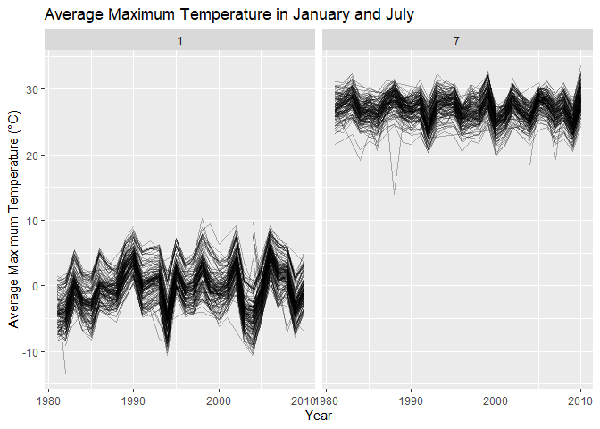
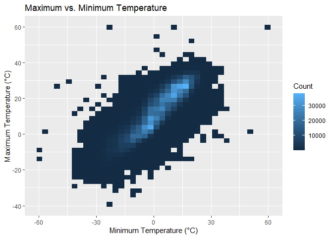
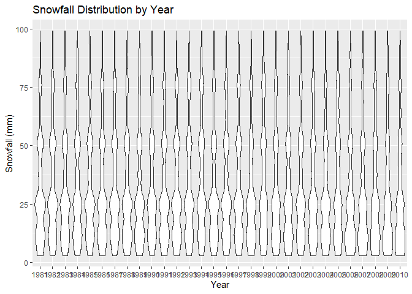
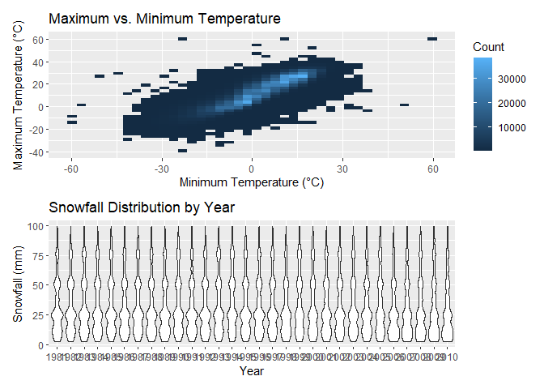

P8105 Homework 3
================
Astrid Xu
2026-10-18

### Q1

``` r
library(p8105.datasets)
data("ny_noaa")
```

``` r
# Data Overview
glimpse(ny_noaa)
```

    ## Rows: 2,595,176
    ## Columns: 7
    ## $ id   <chr> "US1NYAB0001", "US1NYAB0001", "US1NYAB0001", "US1NYAB0001", "US1N…
    ## $ date <date> 2007-11-01, 2007-11-02, 2007-11-03, 2007-11-04, 2007-11-05, 2007…
    ## $ prcp <int> NA, NA, NA, NA, NA, NA, NA, NA, NA, NA, NA, NA, NA, NA, NA, NA, 3…
    ## $ snow <int> NA, NA, NA, NA, NA, NA, NA, NA, NA, NA, NA, NA, NA, NA, NA, NA, 3…
    ## $ snwd <int> NA, NA, NA, NA, NA, NA, NA, NA, NA, NA, NA, NA, NA, NA, NA, NA, 0…
    ## $ tmax <chr> NA, NA, NA, NA, NA, NA, NA, NA, NA, NA, NA, NA, NA, NA, NA, NA, N…
    ## $ tmin <chr> NA, NA, NA, NA, NA, NA, NA, NA, NA, NA, NA, NA, NA, NA, NA, NA, N…

``` r
# Check Missing Data
ny_noaa |>
  summarize(
    id_missing = sum(is.na(id)),
    date_missing = sum(is.na(date)),
    prcp_missing = sum(is.na(prcp)),
    snow_missing = sum(is.na(snow)),
    snwd_missing = sum(is.na(snwd)),
    tmax_missing = sum(is.na(tmax)),
    tmin_missing = sum(is.na(tmin))
  )
```

    ## # A tibble: 1 × 7
    ##   id_missing date_missing prcp_missing snow_missing snwd_missing tmax_missing
    ##        <int>        <int>        <int>        <int>        <int>        <int>
    ## 1          0            0       145838       381221       591786      1134358
    ## # ℹ 1 more variable: tmin_missing <int>

The ny_noaa dataset contains daily weather observations recorded at
weather stations across New York State, with 2,595,176 observations and
7 variables: station ID, observation date, precipitation, snowfall, snow
depth, maximum temperature, and minimum temperature. Only station ID and
observation date have no missing values, while all other variables
contain substantial missing data. In particular, nearly half of the
observations are missing temperature measurements. Since we do not know
why these values are missing or whether there are any underlying
patterns in the missingness, the missing temperature data may introduce
bias into our overall assessment of climate conditions, potentially
leading to overestimation or underestimation of temperature extremes.

``` r
# Data Cleaning
ny_noaa = ny_noaa |>
  mutate(
    tmax = as.numeric(tmax) / 10,
    tmin = as.numeric(tmin) / 10
  )
ny_noaa = ny_noaa |>
  mutate(
    prcp = prcp / 10
  )
ny_noaa = ny_noaa |>
  mutate(
    year = year(date),
    month = month(date),
    day = day(date)
  )

glimpse(ny_noaa)
```

    ## Rows: 2,595,176
    ## Columns: 10
    ## $ id    <chr> "US1NYAB0001", "US1NYAB0001", "US1NYAB0001", "US1NYAB0001", "US1…
    ## $ date  <date> 2007-11-01, 2007-11-02, 2007-11-03, 2007-11-04, 2007-11-05, 200…
    ## $ prcp  <dbl> NA, NA, NA, NA, NA, NA, NA, NA, NA, NA, NA, NA, NA, NA, NA, NA, …
    ## $ snow  <int> NA, NA, NA, NA, NA, NA, NA, NA, NA, NA, NA, NA, NA, NA, NA, NA, …
    ## $ snwd  <int> NA, NA, NA, NA, NA, NA, NA, NA, NA, NA, NA, NA, NA, NA, NA, NA, …
    ## $ tmax  <dbl> NA, NA, NA, NA, NA, NA, NA, NA, NA, NA, NA, NA, NA, NA, NA, NA, …
    ## $ tmin  <dbl> NA, NA, NA, NA, NA, NA, NA, NA, NA, NA, NA, NA, NA, NA, NA, NA, …
    ## $ year  <dbl> 2007, 2007, 2007, 2007, 2007, 2007, 2007, 2007, 2007, 2007, 2007…
    ## $ month <dbl> 11, 11, 11, 11, 11, 11, 11, 11, 11, 11, 11, 11, 11, 11, 11, 11, …
    ## $ day   <int> 1, 2, 3, 4, 5, 6, 7, 8, 9, 10, 11, 12, 13, 14, 15, 16, 17, 18, 1…

``` r
# Snowfall Common Value
ny_noaa |>
  group_by(snow) |>
  summarize(n = n()) |>
  arrange(desc(n))
```

    ## # A tibble: 282 × 2
    ##     snow       n
    ##    <int>   <int>
    ##  1     0 2008508
    ##  2    NA  381221
    ##  3    25   31022
    ##  4    13   23095
    ##  5    51   18274
    ##  6    76   10173
    ##  7     8    9962
    ##  8     5    9748
    ##  9    38    9197
    ## 10     3    8790
    ## # ℹ 272 more rows

The most commonly observed snowfall value is 0 mm, which has 2,008,508
observations. This makes sense because the dataset includes observations
throughout the year, and New York only expects snowfall in several
winter days.

``` r
# January and July Plots
noaa_temp = ny_noaa |>
  filter(month == 1 | month == 7)

noaa_temp = noaa_temp |>
  group_by(id, year, month) |>
  summarize(
    mean_tmax = mean(tmax, na.rm = TRUE)
  )

noaa_temp |>
  ggplot(aes(x = year, y = mean_tmax, group = id)) +
  geom_line(alpha = 0.3) +
  facet_grid(. ~ month) +
  labs(
    title = "Average Maximum Temperature in January and July",
    x = "Year",
    y = "Average Maximum Temperature (°C)"
  )
```

<!-- --> The
plot shows a clear seasonal difference in average maximum temperatures
between January and July. In January, average maximum temperatures
fluctuate around 0°C, while in July, they generally range between 25°C
and 30°C. This is reasonable given the natural temperature differences
between winter and summer. Weather stations show similar year-to-year
fluctuations within each month, with no obvious long-term increasing or
decreasing trend. A few potential outliers can also be observed,
particularly an unusually low temperature in January during the early
1980s and another unusually low temperature in July during the late
1980s.

``` r
# Temperature Plot
# I first tried scatterplot, but the dataset was too large and R was stuck for nearly an hour. I then realized that it needs to be grouped into bins before plotting.
temp_plot = ny_noaa |>
  ggplot(aes(x = tmin, y = tmax)) +
  geom_bin2d(bins = 40) +
  labs(
    title = "Maximum vs. Minimum Temperature",
    x = "Minimum Temperature (°C)",
    y = "Maximum Temperature (°C)",
    fill = "Count"
  )
print(temp_plot)
```

<!-- -->

``` r
# Snow Plot
snow_plot = ny_noaa |>
  filter(snow > 0, snow < 100) |>
  ggplot(aes(x = factor(year), y = snow)) +
  geom_violin() +
  labs(
    title = "Snowfall Distribution by Year",
    x = "Year",
    y = "Snowfall (mm)"
  )
print(snow_plot)
```

<!-- -->

``` r
# Two-panel Plot
temp_plot / snow_plot
```

<!-- -->
